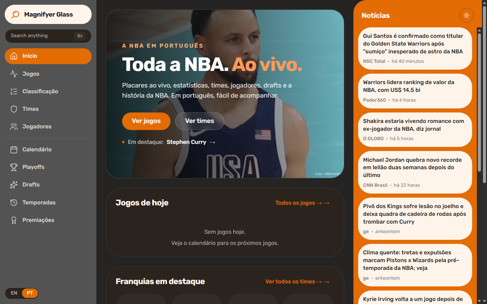
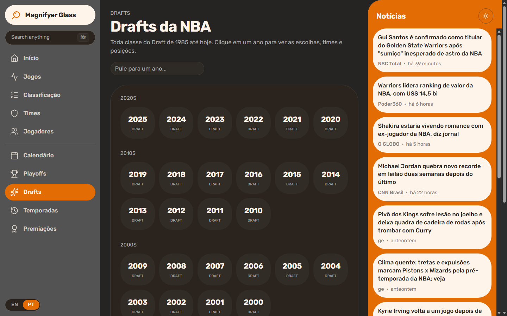
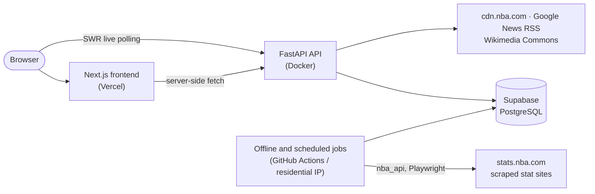

# Magnifyer Glass

[](https://github.com/thxcabra/Magnifyer-Glass/actions/workflows/ci.yml)
[](LICENSE)


An NBA app **for everyone** — live scores, standings, the playoff bracket, the
full schedule, teams, players, drafts, awards, news and player photos. Built
**Portuguese-first** (auto-detected from the browser, English available) with a
light/dark theme.

## Screenshots

<p align="center">
  
  
</p>

## Features

- **Jogos / Games** — today's scoreboard (live, auto-refreshing) + per-game box
  score and play-by-play.
- **Classificação / Standings** — conference standings for the current season.
- **Playoffs** — live bracket (West on the left, East on the right, Finals in
  the middle).
- **Calendário / Schedule** — the whole season, navigable by date, linking to
  each game's box score.
- **Times / Teams** — rosters by season, championship history, lore, team-tinted
  headers, and team news.
- **Jogadores / Players** — profiles with season-by-season stats, percentile
  bars, body composition, awards, recent game logs, archetype classification, a
  free action photo, and player news. Browse/filter by archetype.
- **Drafts**, **Anos / Years** (season summaries), **Listas / Lists** (award
  history) — the historical/differentiator sections.
- **⌘K** command palette, news feeds, i18n (pt-BR / en), light & dark themes.

## Stack

| Layer | Tech |
| --- | --- |
| Frontend | Next.js 16 (App Router), React 19, TailwindCSS 4, shadcn/ui, Recharts, SWR |
| Backend | FastAPI (Python 3.12), slowapi rate limiting |
| Database | Supabase (PostgreSQL, cloud) |
| Live data | `cdn.nba.com` proxy + Google News RSS + Wikimedia Commons (no DB) |
| Catalog ingest | `nba_api` + Playwright/BeautifulSoup + pandas (offline jobs) |
| CI / scheduling | GitHub Actions (CI, daily refresh, weekly recompute) |
| Tests | pytest (backend), Vitest (frontend) |

## Architecture



## How data flows

- **Live / on-demand (works anywhere, incl. cloud):** scores, schedule,
  standings, playoff bracket, box scores, play-by-play, recent game logs come
  from `cdn.nba.com` (header-gated, not IP-gated); news from Google News RSS;
  player photos from Wikimedia Commons (with attribution). All proxied by the
  backend with short in-memory caches — **no schema required**.
- **Catalog (nightly):** the players / season-stats / awards / standings-history
  tables are refreshed by jobs using `nba_api` (`stats.nba.com`). That host
  **blocks datacenter IPs**, so run those from a residential IP / self-hosted
  runner — not from the cloud web host.

## Layout

```
magnifyer-glass/
├── backend/                      # FastAPI service
│   ├── app/
│   │   ├── core/                 # config, supabase client, rate limit, security headers
│   │   ├── api/routes/           # players, discovery, teams, draft, years, lists,
│   │   │                         #   live, news, photos, game-log, health
│   │   ├── services/             # nba_live, news, wiki_photo, player_gamelog, archetypes…
│   │   ├── scrapers/ + jobs/      # offline nba_api/Playwright ingest + cron jobs
│   │   └── main.py
│   ├── tests/                    # pytest
│   ├── Dockerfile + requirements-web.txt   # slim always-on web image
│   └── requirements.txt          # full deps (jobs/scrapers)
├── frontend/                     # Next.js 16 app (src/app, src/components, src/lib)
├── db/migrations/                # Supabase SQL migrations
├── .github/workflows/            # CI + nightly/weekly crons
├── DEPLOY.md
├── LICENSE
└── README.md
```

## Local setup

Prerequisites: Python 3.12, Node.js 22 (the version CI uses) and a Supabase
project.

### 1. Database
Create a Supabase project, copy the URL + service-role key, then apply the SQL
in `db/migrations/` (in order) via the SQL editor.

### 2. Backend (Python 3.12)
```powershell
cd backend
python -m venv .venv
.venv\Scripts\activate
pip install -r requirements.txt          # full deps (for jobs); web-only: requirements-web.txt
python -m playwright install chromium     # only for the NCAA / international scrapers
copy .env.example .env                    # then fill SUPABASE_URL / SUPABASE_SERVICE_KEY
uvicorn app.main:app --reload
```
On macOS/Linux activate with `source .venv/bin/activate` and copy with `cp`.

Health check: `GET http://localhost:8000/health` → `{"status":"ok"}`.

### 3. Frontend (Next.js 16)
```powershell
cd frontend
npm install
copy .env.example .env.local              # defaults point at localhost
npm run dev                               # http://localhost:3000
```

## Environment variables

**Backend** (`backend/.env`, see [backend/.env.example](backend/.env.example)):

| Name | Required | Description |
| --- | --- | --- |
| `SUPABASE_URL` | yes | Supabase project URL (Settings → API) |
| `SUPABASE_SERVICE_KEY` | yes | Supabase service-role key — secret, server-side only |
| `API_CORS_ORIGINS` | no | Comma-separated allowed origins (default `http://localhost:3000`) |
| `PORT` | no | Port used by the Docker image (default `8000`; injected by most hosts) |

`.env.example` also lists `SUPABASE_ANON_KEY`, `API_HOST` and `API_PORT`; the
settings class accepts them, but the current code does not read them (uvicorn's
`--host` / `--port` flags control binding).

**Frontend** (`frontend/.env.local` locally, project env vars on Vercel; see
[frontend/.env.example](frontend/.env.example)):

| Name | Required | Description |
| --- | --- | --- |
| `NEXT_PUBLIC_API_BASE` | in production | Backend base URL (default `http://localhost:8000`) |
| `NEXT_PUBLIC_SITE_URL` | in production | Public site URL for metadata, sitemap and robots (default `http://localhost:3000`) |

**GitHub Actions secrets** (daily/weekly jobs): `SUPABASE_URL`,
`SUPABASE_SERVICE_KEY`.

## Tests
```powershell
cd backend
pytest                        # services (live/standings/playoffs/news/game-log) + smoke
cd ../frontend
npm test                      # Vitest: utils & formatting
```
The backend tests need no `.env`: `tests/conftest.py` sets dummy Supabase
values, and no test talks to Supabase. CI runs ruff + pytest for the backend
and tsc + ESLint + Vitest + `next build` for the frontend.

## Catalog ingest (offline / residential IP)
```powershell
python -m app.scrapers.nba_api_loader --start-season 2005-06 --end-season 2025-26   # backfill: stats / hustle / combine
python -m app.jobs.daily_refresh                          # current season + reclassify archetypes
```

## Archetypes
Every player is classified into one of the tactical archetypes (Helio-Centric
Creator, Floor General, 3-and-D, Stretch Big, Rim Protector, …) by percentile
thresholds — see [backend/app/services/archetypes.py](backend/app/services/archetypes.py).
Browse players by archetype from the ⌘K palette or `/players?archetype=…`.

## Deployment
See [DEPLOY.md](DEPLOY.md) — Vercel (frontend) + a slim Docker web image on
Render/Railway/Fly (backend) + Supabase, with the nightly jobs on a residential
IP. Live features run fine on any cloud host.

## License

[MIT](LICENSE) © 2026 João Cabral

## Author

**João Cabral** — [GitHub](https://github.com/thxcabra) · [LinkedIn](https://www.linkedin.com/in/joao-cabral-machado/) · [Portfolio](https://thxcabra.github.io/portfolio/#/projetos/1)
